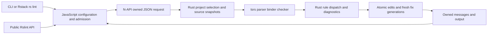

# Architecture Overview

Rslint executes its supported lint rules in Rust using pinned tsrs parser,
binder, module resolution and checker APIs. Node.js loads the Rust cdylib
through N-API; the normal CLI and public `Rslint` class use this same in-process
path. No compiler subprocess, Go facade, Go WASM or runtime download is used.

The current migration accepts the 129 rules enabled by the frozen Rsbuild
workload, with all 2394 admitted files, effective options and severities retained.
Ten previously implemented rules remain available. Unknown rules and unsupported
options or entrypoints fail explicitly. Declaration coverage is not a claim of
complete semantic compatibility; see `docs/tsrs-migration/REPORT.zh-CN.md`.

## Runtime flow

JavaScript loads explicit configuration, normalizes options and discovers the
complete file set using the configured ignores and overrides. Project policies
and effective rules are attached per file. An admitted file remains in the
result even when it is silent or has no type checker. Automatically discovering
configuration modules and external JS rule plugins are not yet implemented in
this migration; they are rejected rather than silently skipped.

Rust selects configured projects according to each file's policy and binds a
file only when it is in that project's root set. Files with no selected project
use the source-only Program; importing a file does not grant it a typed target
capability. Config path, current directory, root membership and compiler options
are independently observable through `planTsrsSync`. The source-only host cwd
can differ from admission cwd when an explicit configuration is elsewhere.

The configured execution entrypoint `lintProjectsTsrsSync` builds the selected
Programs, dispatches all enabled rules, and returns actual `appliedRules` and
type-capability metadata for each file. The low-level `lintTsrsSync` entrypoint
remains for explicit compiler requests and focused tests. They share rule
implementations, owned diagnostic values, source encoding and fix application.
Metadata planning alone is not proof that rule execution or type queries ran.

## Ownership and fixes

JavaScript admission owns an invocation-local cache of pure path coordinates
and successful realpath results. Ignore rules and configuration matching share
those coordinates without retaining filesystem state across calls. The CLI uses
one validated admission for source snapshots and native execution; the snapshot
reader receives only accepted file paths and returns source text, never a
fabricated file list. Disk fixes still validate canonical path, inode and original
bytes before writing.

AST, symbol and type pointers stay inside Rust. A generation shares immutable
parsed and bound source files between its Programs using the complete parse
options, script kind and exact source content as the cache key. Each shared
source owns a registered region for parsing, binding and source-owned lazy
allocations. The generation and compiler hosts retain these regions until all
Programs and checker pools have been released; checker state remains specific
to its Program. Only owned requests, diagnostics, scheduling metadata and output
strings cross N-API. No compiler pointer is retained in JavaScript or across a
fix generation.

A lint generation observes frozen source text with canonical path aliases and
memory overlays. Host probes and successful source reads are cached within that
generation; failed source reads can retry. Replacing or clearing the generation
releases those caches. Rules register listeners by AST kind once per file,
preserving configuration order within each listener bucket; unaudited kind
metadata conservatively retains every node. Fixes are validated as one transaction: conflicting edits are
not partially applied. Changed sources trigger fresh project/type state before
the next generation, with a bounded fix loop and a final diagnostic observation.
The CLI projects accepted output to disk; public lint APIs return output without
implicitly writing files. UTF-8/BOM decoding and UTF-16 public ranges remain
separate from internal byte spans.

Suppression and global comments come from parser-owned comment trivia, not raw
string matching. Per-file global metadata uses a scoped owned cache during rule
execution and is released on normal, error and panic exits. It cannot retain an
arena reference for a later generation.

## Source layout

| Path                                     | Responsibility                                                                         |
| ---------------------------------------- | -------------------------------------------------------------------------------------- |
| `crates/rslint-core`                     | Rule implementations, projects/Programs, source snapshots, diagnostics and fixes       |
| `crates/rslint-native`                   | N-API boundary, owned payload validation and legacy AST compatibility helpers          |
| `packages/rslint/src/rust`               | Configuration, admission, configured native requests, CLI and public API orchestration |
| `packages/rslint/bin/rslint.js`          | Node CLI wrapper                                                                       |
| `packages/rslint-api`                    | Checked-in JavaScript AST compatibility data/types with upstream attribution           |
| `npm/rslint/*`                           | Platform-specific Rust `.node` packages                                                |
| `vendor/typescript-libs`                 | Licensed, content-pinned baseline declaration resources                                |
| `scripts/tsrs/prepare-rust-compiler.mjs` | Reproducible committed-source preparation and Rust compatibility patches               |
| `scripts/tsrs/build-rust.mjs`            | Locked Rust addon build, target validation and atomic artifact placement               |
| `scripts/tsrs/rust-*`                    | Current coverage, correctness oracles, absence checks and workload benchmark tools     |

Historical Go implementation, compiler submodule, bridge crates and build tools
are archived outside the candidate tree. Git history preserves original source
and licenses. LSP, browser WASM and legacy service/internal/plugin subpaths are
not advertised as migrated; explicit unsupported shims prevent fallback.

## Build and comparison boundaries

The product build needs Rust, a native linker and Node/pnpm. The compiler
preparer fetches only the pinned committed tsrs source, applies tracked Rust
patches, embeds the pinned declaration resources, and writes an ignored explicit
Cargo configuration. All tsrs packages use that one graph. No uncommitted local
compiler source or TypeScript Go checkout is required. Declaration generation
uses pinned JavaScript TypeScript with `dts.tsgo: false`.

The original tsgo backend lives in an external immutable checkout solely as a
correctness/performance oracle. It is not bundled in the product. Real-workload
comparison fixes files, effective rules, compiler/library revisions, dependencies,
threads and caches; validates complete diagnostic/fix results before measuring;
and includes Node/native startup and shutdown plus whole-process-tree sampled
RSS. Shared-machine builds and measurement batches hold the cooperating machine
lock. The repeatable commands and evidence boundaries are documented under
`docs/tsrs-migration`.
